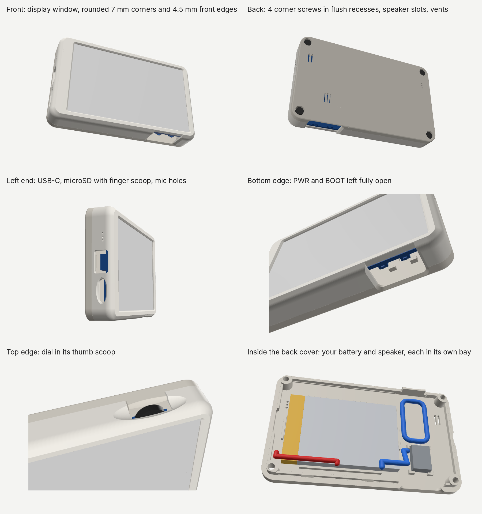
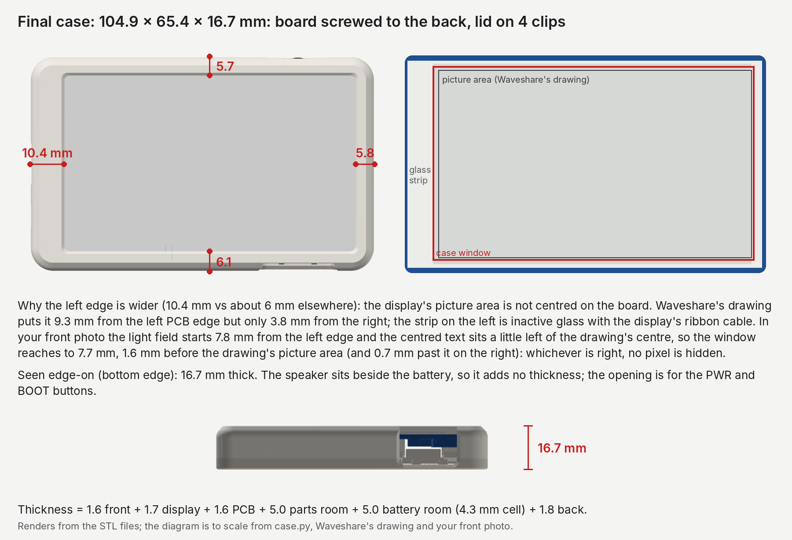

# Case for the Waveshare ESP32-S3-ePaper-3.97

A two-piece case with rounded edges for the Waveshare ESP32-S3 3.97" e-Paper board (SKU 33552, part number `ESP32-S3-ePaper-3.97`), with room inside for its 3.7 V 1500 mAh LiPo (Waveshare model 454261) and its speaker **side by side**. It measures 104.9 x 65.4 x 16.7 mm. This version is printed in **PLA**.

**How it holds together.** The board is **screwed to the back cover** through its four brass corner standoffs, with four screws from the back. The **front lid**, a frame round the display, then **snaps onto the back cover** with four clips, two on each long edge. Nothing covers the display, and the lid never presses the board or the glass. To open it, put a fingernail or a guitar pick into the notch in the right-hand end.

**Sized from your own parts.** The battery bay and the speaker pocket are made for the battery and speaker in your photos. Their sizes were read off the ruler in those photos (see [Where the numbers come from](#where-the-numbers-come-from)). The battery sits in a 62.5 x 42.5 mm bay with guides on all four sides. The speaker sits in its own pocket, sound side down over three slots. Both go in easily, and once taped in neither can rattle.

## Files

| File | What it is |
|---|---|
| `stl/front_shell_battery.stl` + `stl/back_cover_battery.stl` | The two parts to print: the front lid and the back cover. |
| `docs/assembly_guide_en.pdf`, `docs/assembly_guide_bg.pdf` | Illustrated assembly guide in English and Bulgarian: what to buy, printing, and every step. |
| `dist/` | The zip to download: the two STL files, this README, the renders, the measurements and the assembly guides. `make_zips.py` rebuilds it. |
| `case.py` | Parametric generator. Every dimension is a named constant at the top. |
| `verify.py` | Quick fit check, with 4 mm and 3 mm standoffs: collisions, both insertion paths, the screws, pad and glass clearances. |
| `checks/` | The debugging rounds (see [DEBUG_LOG.md](DEBUG_LOG.md)). `checks/run_checks.py` runs them, skipping any that already passed with the same inputs. `checks/owner_photos/` holds crops of your photos for rounds 28, 35 and 44. |
| `preview/` | Renders, cross-sections, the openings drawn onto Waveshare's photos, and `preview/owner_measurements.png`: your photos with every ruler tick, edge and landmark the measurements used. |
| `docs/guide-src/` | Everything the guides and `preview/renders.png` are built from (`docs/guide-src/build_all.sh` rebuilds them). |

## You also need

**4 × M2.5 × 8 mm screws**, 8 mm long under the head, with a pan, cheese or button head **no more than 5.0 mm across and 1.8 mm tall**, flat underneath (not countersunk). ISO 7045 pan heads (5.0 x 1.75 mm) are a good choice; DIN 7985 ones are 2.0 mm tall and stand 0.2 mm proud. They go through the four corners of the back cover into the board's brass standoffs (see `preview/screw_locations.png`). Don't use other lengths: 7 mm or less barely reaches the thread, and 9 mm or more can reach the board if your standoffs are 3 mm tall.

**If your standoffs turn out to be M2** (an M2.5 screw won't start in them): use **4 × M2 × 8 mm** screws of the same kind instead, each with an **M2 washer** under its head (ISO 7089 / DIN 125, 5 mm across, 0.3 mm thick). The holes are sized for M2.5, so an M2 head alone is too small to seat reliably.

**Thin double-sided tape** (0.1–0.2 mm, the ordinary kind): one piece under the battery, and a frame of it round the speaker's membrane (see Assembly).

## Features

- **Display window:** 88.7 x 53.6 mm, placed from Waveshare's dimension drawing and your front photo. The active area is 86.4 x 51.84 mm, so there is at least 0.7 mm of margin all round, and 1.6 mm on the left: in your front photo the light field starts 8.0 mm from the left end and the centred text sits 1.2 mm left of the drawing's centre, so the picture may start up to about 1.2 mm earlier than the drawing says, and the window covers that too. The window edge has a 45° chamfer.
- **Why the left end of the frame is wider (10.4 mm vs about 6 mm elsewhere):** the display's picture area is not centred on the board. It starts 9.3 mm from the left PCB edge but ends 3.8 mm from the right one. The strip in between is inactive glass and the display's ribbon cable, so the window can't go further left without showing it (see `preview/explained.png`).
- **Board screwed to the back:** each corner of the back cover has a post that stands on one of the board's brass standoffs, exactly where a 4 mm standoff ends. An 8 mm screw seated in its recess then goes **2 mm into the standoff**, whether your standoffs are 3 or 4 mm tall (with 3 mm ones the board just sits 1 mm further back, and the display 1 mm deeper behind the window). The heads sit flush in 6.2 mm recesses in the back, 1.8 mm deep. The standoff positions are estimates (Waveshare's photos and yours differ by up to 0.7 mm), so the holes are 3.4 mm: a screw can sit 0.4 mm off centre and still pass and seat. The back's outer edge is rounded only 0.8 mm (the front 4.5 mm) so the recesses keep about 1 mm of wall at the corners.
- **No load on the glass:** the lid's plate is 0.3 mm thinner over the glass, so it sits about 0.8 mm in front of it (1.8 mm with 3 mm standoffs). Small pads along the PCB's top, bottom and right edges stop 0.5 mm short of it (enough for the slicer's rounding and a thicker board): they never press the board, but they hold it off the glass while you close the case. The left end has no pad because the glass edge is too close to the PCB edge there.
- **Snap clips:** four, two in each long edge. Each is a 28 mm stretch of the back cover's skirt, freed from the cover by a thin slot so it is held only at its two ends, with a hook in its middle that catches a groove inside the lid's wall. The beams bend sideways, in the plane of the print layers, which is the strong direction in PLA (a hook bending across the layers would snap off). They bend 1.0 % at most (1.6 % if the lid prints 0.15 mm small inside and the cover 0.15 mm large outside), well under PLA's limit, so the lid can be taken off and put back many times; with the errors the other way round the hooks still reach 0.25 mm past the lid's wall. Closed, each stays bent 0.1 mm, so the lid can't rattle. Pressing the lid on takes about 17 N (a firm press with both thumbs); pulling it straight off takes about 29 N. A 30° chamfer inside the lid's rim lets the hooks ride in.
- **Opening:** a small notch in the right-hand end, right on the seam. Put a fingernail or a guitar pick into it, lever the lid away from the back, and work along both long edges until the clips let go. The board stays screwed to the back cover.
- **PWR and BOOT:** nothing covers them. The bottom wall is left out in front of both switches: an opening 22.0 mm wide, open from the front face up past the seam, with bevelled edges. A fingertip reaches the switches straight on or tilted 15° in any direction, and 30° from the front or back. Tilted 30° sideways toward an end of the opening, a fingertip stops about 3 mm short, so press those roughly straight on. The display lip stays continuous above the opening.
- **USB-C:** a 13 x 8 mm opening with 1.2 mm corner radius (a 13 x 7 opening made 1 mm taller toward the back, so cable plugs seat fully with 3 or 4 mm standoffs).
- **microSD:** a slot with a finger scoop, also 1 mm taller toward the back. The latched card sits about 4 mm inside the outer wall, so press it with a fingernail or a pen tip to eject it.
- **Dial (UP / DOWN / press):** the wheel rim is exposed through a slot with a thumb scoop. The back cover has a tab that closes the slot above the wheel.
- **Battery bay:** 62.5 x 42.5 mm and 5 mm deep, for your 61.1 x 40.7 x 4.3 mm cell. Guide bars 2 mm tall run along all four sides, so the cell can slide about 0.9 mm at most. The four corners are left open, so the wire can leave from whichever corner of the taped end yours comes out of. The tape under the cell holds it still.
- **Speaker pocket:** 11.2 x 15.3 mm, for your 14.2 x 10.2 x 4.5 mm speaker, turned lengthways. It's about 0.5 mm bigger than the speaker on every side. Four L-shaped corner brackets locate it. Their legs are short, so the middle of every side stays open for the speaker's white peg and its cable. The pocket is kept 7.9 mm from the ESP32's antenna so the speaker's magnet doesn't hurt Wi-Fi/Bluetooth range.
- **Speaker grille:** three 0.9 x 7.0 mm slots, all under the speaker's membrane (about 10 x 6 mm) and well inside its sealed face. Sound from the back of the speaker can't leak out round its edge and cancel the front. The slots are 0.9 mm apart, so the webs between them print solidly.
- **Vents:** holes for the microphone (left side and back) and the temperature/humidity sensor (right side and back).

## Printing

- **PLA** (this version), **0.2 mm layers or finer** (0.1–0.2 mm), 3 perimeters, 15–20 % infill. **No supports needed.** Don't use 0.3 mm layers: the clips' hooks are under 1 mm tall, so their 45° faces would print as three coarse steps.
- **PLA softens at about 55 °C.** Keep the case out of direct sun, off sunny windowsills and out of a parked car. PLA is also more brittle than PETG: don't over-tighten the screws. **PETG** or **PCTG** would be tougher and take heat better, and need no other change.
- **ASA or ABS:** these shrink more as they cool (roughly 0.5–0.7 %, depending on the brand), enough to make the board too tight. Turn on your slicer's XY shrinkage compensation for that filament (PrusaSlicer and OrcaSlicer have it in the filament settings) or print in PLA/PETG. PLA and PETG (about 0.2–0.4 %) need nothing.
- **Front lid:** print display side down. The front edge uses an arc that ends in a 45° chamfer, so it prints cleanly against the bed.
- **Back cover:** the STL is already flipped. Print it outside face down. The clip beams print as short bridges over their slots; keep the part cooling fan on.
- **Material:** about 27 g of PLA for both parts with these settings (PrusaSlicer's estimate). Its generic profile estimates about 3 hours; a fast printer takes much less.
- **Print the back cover first** (about 16 cm³) and lay it on the board's back: through each corner hole you should see the middle of a standoff's threaded hole, and each screw should start a few turns by hand. Then print the lid (about 8 cm³).

## Assembly

1. Put the board face-down into the front lid. The dial drops into the notch on the top edge, and the PWR/BOOT switches sit in the opening in the bottom wall. The board rests on the small pads round its edge.
2. Hold the back cover with its inside facing you and the dial tab at the top, so the USB-C end is on your left (as in the guide's step 2 picture).
   - **Battery:** stick a piece of thin double-sided tape in its bay and press the cell in, **taped end (with the wire) toward the USB-C end** (left). If the wire comes out of the top corner of that end, turn the cell over so it comes out at the bottom corner. Plug it into **BAT**.
   - **Speaker:** it goes in its pocket next to the battery, **membrane side down** (the side with the white membrane in a black ring faces the slots), and **with its white peg pointing to the top edge**. Its cable then comes out on the side facing the battery. Stick it down with a frame of thin double-sided tape round the membrane: cut a window in the tape so the membrane stays uncovered, and the speaker seals against the cover. Plug it into **SPK**.
   - **Wires:** both run along the bottom edge of the board to the BAT and SPK connectors; the checked routes are about 38 mm and 30 mm long, with gentle bends (none tighter than 3 mm on the speaker's sleeved cable). The battery wire runs under the battery: tuck the spare length beside it. The speaker cable is much longer (about 10–11 cm). Lay the spare in one loop on the cover above the speaker, where there's room for about 8 cm, and hold it with a strip of tape. Keep it off the right-hand end, where the ESP32's antenna is, and away from the four corner posts and the long edges, where the clips are.
3. Put the back cover on. With the wires plugged in, **turn it over like the page of a book along the bottom edge**, where the wires run, so they aren't pulled (the battery wire has only about 16 mm to spare). Hold it over the lid with its tab above the slot over the dial, and lower it straight down. Press it down firmly along both long edges until **all four clips click** and the seam is closed all round.
4. Drive in the **4 corner screws** from the back, through the holes in the corners into the brass standoffs. Start each by hand: an M2.5 should turn in easily. If it won't start without force, your standoffs are M2: use the M2 screws with a washer under each head. Tighten them in a cross pattern until each head sits in its recess and the board is held firmly, then stop. **Don't over-tighten**: the brass won't strip, but too much force can crack or squash the PLA posts. The lid has already lined the board up, so the screws find the standoffs.

**Opening:** put a fingernail or a guitar pick into the notch in the right-hand end, lever the lid off and work along both long edges. The board, battery and speaker stay on the back cover; to take the board out, undo the 4 screws. To close it again, press the lid back on until the clips click.

## Where the numbers come from

**Official (Waveshare outline drawing):**
- PCB 99.5 x 60 mm, corner radius 2 mm
- Active display area 86.40 x 51.84 mm

**Display window position:** from the dimension lines on the same drawing. Waveshare's photos agree within about 0.5 mm.

**Measured from your photos** (`checks/round28.py`, drawn in `preview/owner_measurements.png`). The scale comes from the ruler's tick marks, found automatically: 17–43 ticks per photo, with a straight line fitted through them. The edges were picked by eye and then refined to the part's outline (the outermost strong colour step). Expect about ±0.3 mm:
- **Battery:** 61.1 x 40.7 x 4.3 mm, including the taped end. Its wires leave that end at one corner (about 54 mm of free wire). The bay leaves 0.7–0.9 mm on each side of it.
- **Speaker:** 14.2 x 10.2 x 4.5 mm. Its membrane is about 10.1 x 5.8 mm and centred to within 0.3 mm (found by a perspective transform of its frame in your top view). The white peg sticks out about 1.6 mm from one short side, 1 mm off its middle. The cable leaves a long side about 2.9 mm from the peg's end and is about 10–11 cm long. The pocket leaves about 0.5 mm on each side.
- **Your board:** the four standoff tops in your back photo were used as reference points. The USB-C, both buttons, the dial and the top edge land within 0.5 mm of the board model, so your board is the same revision the case was built for.
- **The display, from the front** (`checks/round44.py`): along the ruler in your front photo, the light field runs from 8.0 to 95.2 mm from the left end, and the text on the screen is centred 51.3 mm from it (Waveshare's drawing: picture area 9.3–95.7 mm, centre 52.5). The ruler's scale changes from 16.0 to 15.5 px/mm along the photo (the camera was tilted), so positions are read between its own cm and half-cm ticks. The window now starts at 7.7 mm.
- **Standoff positions** (`checks/round35.py`): the board's edges, the brass rings and the ruler in your back photo, corrected for the standoff tops being about 4 mm nearer the camera than the board (which makes them look up to 0.5 mm further out). With the point under the camera anywhere within 150 px of the photo's centre, that gives x 2.4–2.7 / 97.0–97.4 and y 2.3–3.1 / 57.0–57.4 mm, against x 2.2 / 96.7 and y 2.85 / 57.4 from Waveshare's photos. The case uses the symmetric layout between them: x 2.45 / 97.05, y 2.725 / 57.275, 94.6 x 54.55 mm apart. Every estimate is within 0.45 mm of it, and for each one the board can sit so that no screw is more than 0.3 mm off its hole's centre; the holes allow 0.4.

**Measured from Waveshare's 1600 x 1200 product photos** (about 10 px/mm, board outline as the scale). Expect about ±0.5 mm error:
- USB-C at mid-height of the left edge
- microSD at y ≈ 14 mm
- Dial centre x ≈ 79 mm; it sticks out 2.0 mm (drawing) to 2.6 mm (photos) past the top edge. The thumb scoop was checked for both
- BOOT at x ≈ 74 mm and PWR at x ≈ 84 mm, sticking out about 0.75 mm
- Mic and sensor positions

**Assumed or estimated** (not published by Waveshare):
- PCB thickness 1.6 mm. It changes how far the glass sits from the lid (0.8 mm with the assumed 1.6 mm board); the checks allow 0.16 mm either way
- Panel stack about 1.2 mm
- Standoffs about 4.5 mm across and 3–4 mm tall (you told me 3–4 mm); their thread M2 or M2.5
- Component heights on the back: 4 mm or less (you found the ESP32 module is the tallest part). With 3 mm standoffs the board sits 1 mm nearer the battery; the checks cover both.
- **Removing the speaker does not make the case any thinner:** the speaker (4.5 mm) sits beside the battery in the same 5 mm layer.

The checks in `checks/` test the case against a model of the board built from these numbers. They are not a substitute for a test print. **Print the back cover first and check the screws line up before printing the lid.**

### If something doesn't fit

Edit the matching constant in `case.py` and run `python3 case.py` (needs `pip install manifold3d numpy`; the checks also need `trimesh scipy shapely rtree networkx matplotlib pillow`):
- **Display window off-centre:** `WIN_CX`, `WIN_CY`
- **Whole board too tight or loose:** `CLR` (sideways)
- **Glass too close to the lid:** `PANEL_T`, `PCB_T`
- **A port misaligned:** `USB_Y`, `SD_Y`, `WHEEL`, `BUTTONS` (the PWR/BOOT opening follows `BUTTONS`, 6 mm past each switch)
- **A corner screw doesn't line up with its standoff:** `POSTS` (the standoff centres; the posts, holes and recesses follow them)
- **Standoffs taller than 4 mm:** `POST_STANDOFF` (the posts get that much shorter)
- **Battery too tight or too loose in its bay:** `BATTERY_BAY` (x0, x1, y0, y1 of the bay; the guides follow it)
- **Speaker too tight or too loose in its pocket:** `SPEAKER_BOX` (the pocket's width and length; the brackets follow it)
- **Tall parts:** `STANDOFF_H` only describes the board for the checks: set it to what you measure and run `python3 verify.py`. If that reports a collision, raise `PARTS_SPACE` (or `BATTERY_SPACE` for a thicker battery), which do change the case

Then run `python3 verify.py` for the quick fit check, or `python3 checks/run_checks.py` for every check from the debugging rounds (about 25 minutes the first time; after that it only re-runs the rounds whose inputs changed, `--all` runs everything). The photo checks download Waveshare's images on first use; where `www.waveshare.com` can't be reached they report SKIP, never a pass. Round 19 onwards slice the parts with PrusaSlicer if `prusa-slicer` is installed.
